# 台北市 Issue Tracker

繁體中文 | [English](README.en.md)


<!-- 本檔是 README.en.md（ASD-STE100 簡化技術英文）的繁體中文翻譯。修改時兩份一起改。 -->

這個網站把台北市呈現成一個 GitHub repo。市民的 1999 陳情是 issue。局處的修繕是 pull request。每月的派工摘要是 release。

這是手機優先的 1999 快速通報網站。市民送出陳情。AI 分類陳情，並分派給負責的局處。陳情會立即出現在地圖上。網站標題是「台北市，你給我聽好了｜市民 1999 通報地圖」。

- 線上網站：<https://taipei-issue-tracker.labanchen.workers.dev>
- 局處後台（示範，免驗證）：<https://taipei-issue-tracker.labanchen.workers.dev/?admin>
- 黑客松題目：[puma.taipei/hackathon](https://puma.taipei/hackathon)「你看見的市政 bug」

> 網站上的陳情、修繕單與 +1 是**模擬資料**，不是台北市政府的真實案件。地圖時間軸與每月派工報告使用 data.taipei 的真實 1999 派工資料。請參閱〈資料來源〉。

## 畫面截圖

以下為 2026-10-24 線上網站的截圖（淺色模式，模擬資料）。

| | |
|---|---|
| 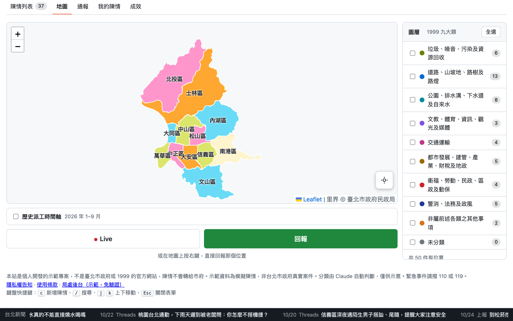<br>**地圖**：12 個行政區與 1999 九大類圖層 | 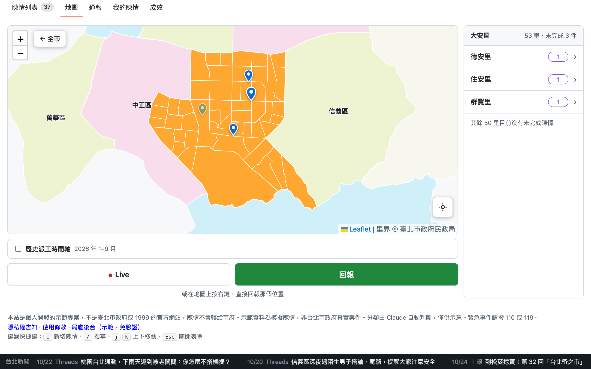<br>**行政區**：各里界與有未完成陳情的里 |
| 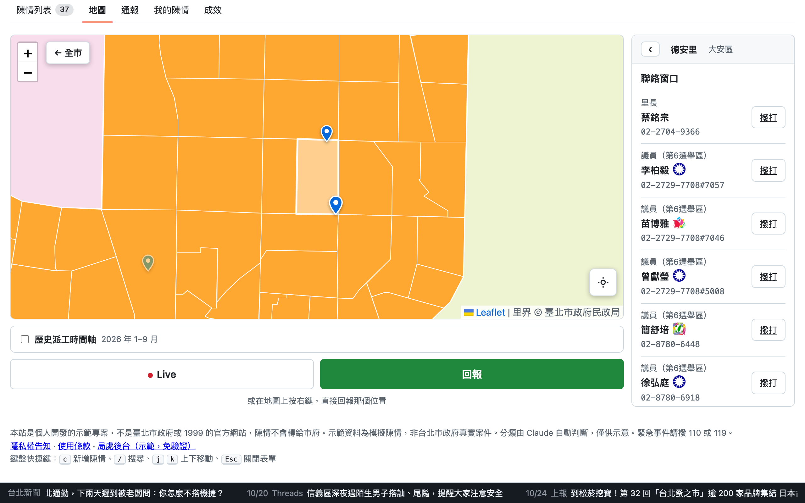<br>**里頁面**：里長、議員與里內陳情 | 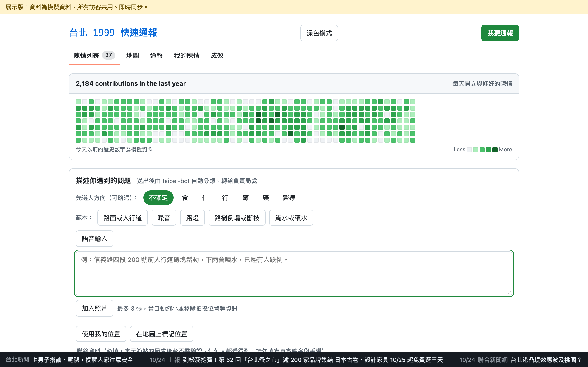<br>**快速通報**：大方向、範本、語音、照片與位置 |
| 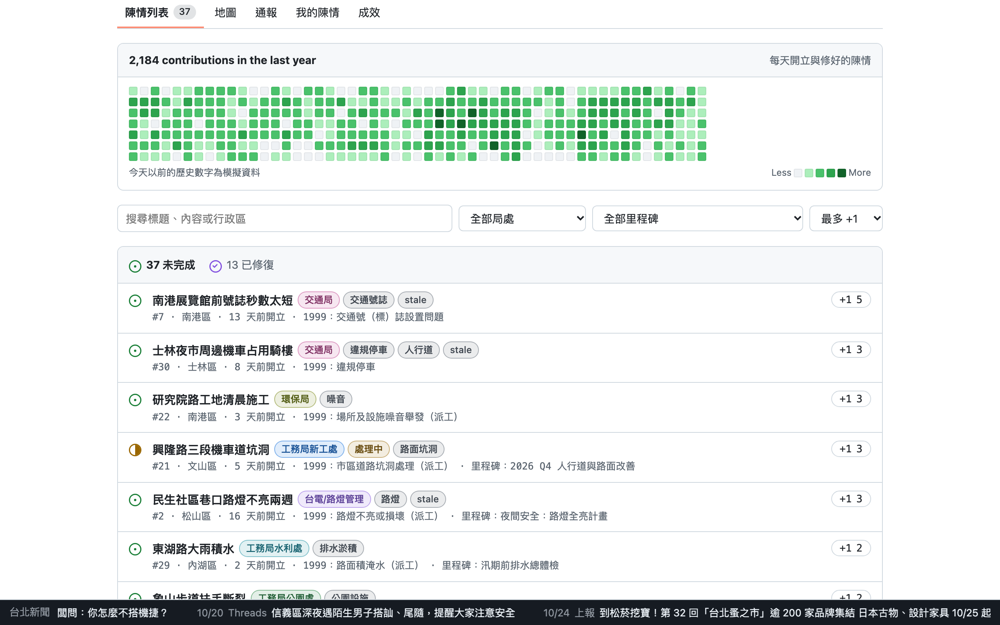<br>**陳情列表**：貢獻圖、篩選與 +1 | 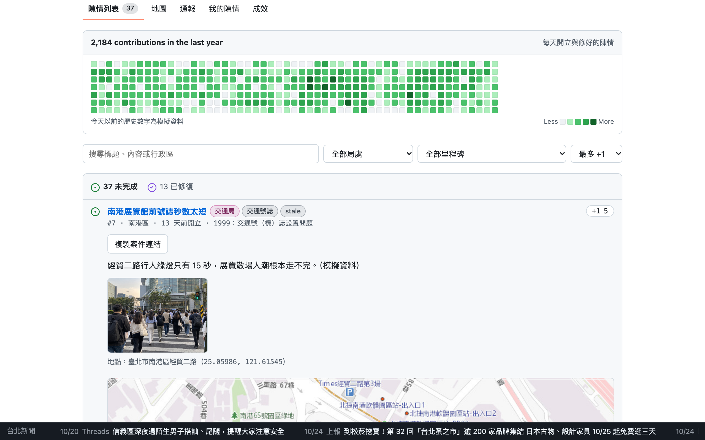<br>**案件詳情**：照片、位置與小地圖 |
| 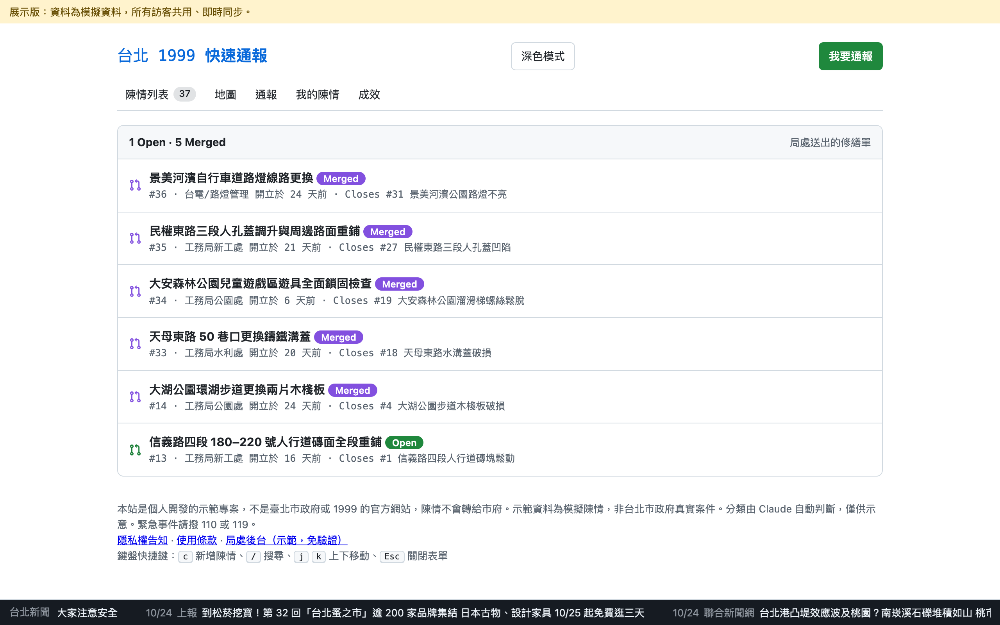<br>**Pull requests**：局處送出的修繕單 | 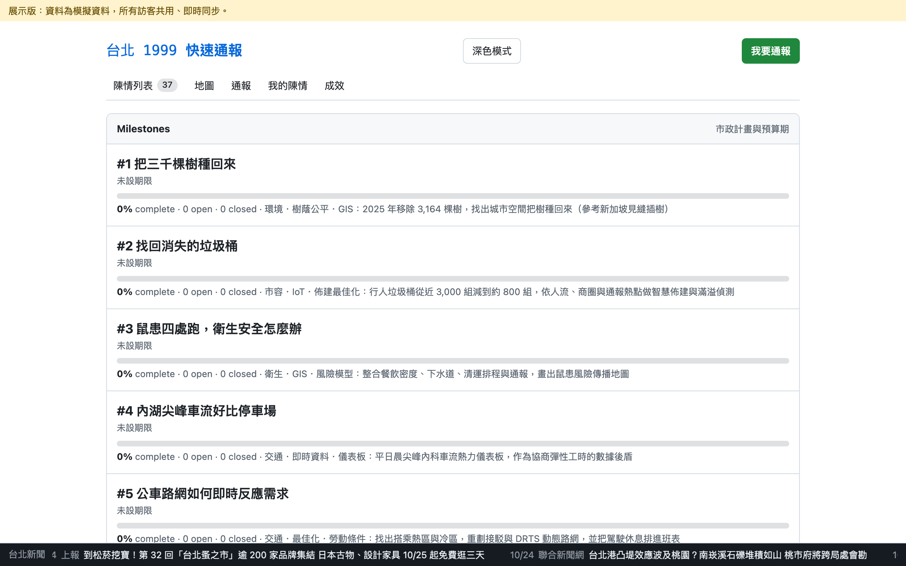<br>**Milestones**：市政計畫與預算期 |
| 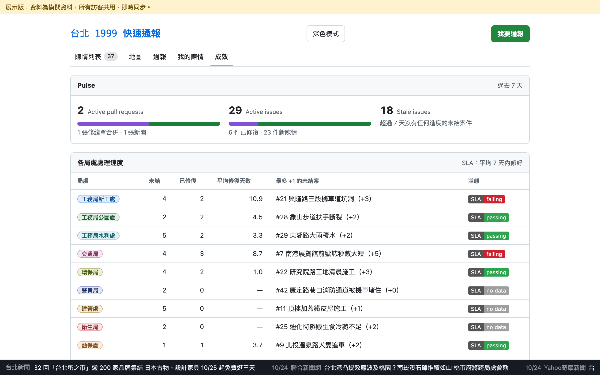<br>**成效**：各局處 SLA | 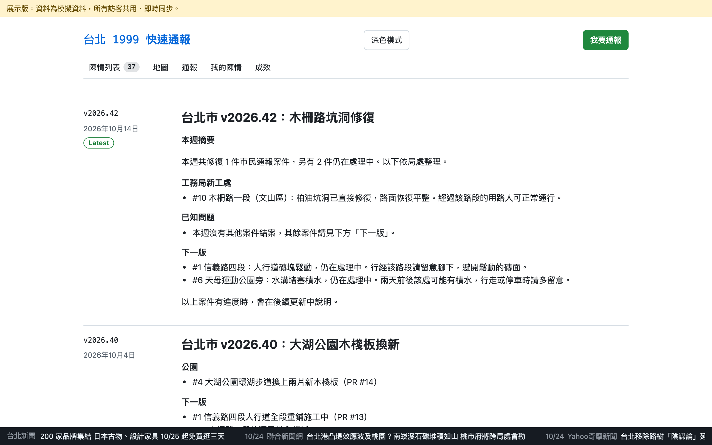<br>**Releases**：每週結案摘要 |

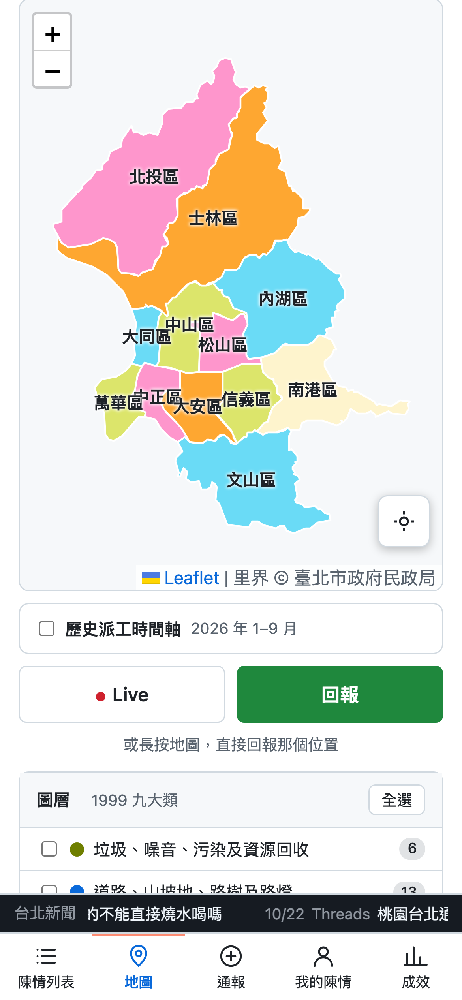<br>**手機版**：地圖與底部導覽列

## 功能

**市民（手機優先）**

- **快速通報**：先選大方向：食、住、行、育、樂或醫療。這一步可以略過。然後描述問題。每個大方向有 3 到 7 個範本（共 33 個）。如果套用範本，但冒號後面沒有填內容，網站會擋下這筆陳情。可以用中文語音輸入，瀏覽器支援時才會顯示語音按鈕。最多可以附上 3 張照片。超過的照片未加入，或照片太大時，網站會顯示原因。
- **聯絡資料**：姓名、手機與 Email 必填。Email 用來通知案件處理進度，目前網站尚未寄出這類通知。新案件沒有有效的聯絡資料時，Worker 會拒絕建立。Worker 會把案件與私有聯絡資料一起保存；重複案被拒絕或新案建立失敗時，不會留下該次嘗試的聯絡資料。重試會保留首次成功儲存的聯絡資料。資料以案件作者身分保存，從管理者分頁送出的通報也一樣。市民畫面不顯示，但示範站的局處後台不需驗證，任何人都能讀到；表單與隱私權告知都提醒市民不要填寫真實個資。如果陳情內容和某人或某個店家有關（例如違規停車、噪音或違建），可以勾選「實名檢舉」。
- **通報欄位**：Worker 只接受標題 1 到 200 字元、內容 1 到 2000 字元，且標籤為字串清單的新案件。標題、內容或標籤格式錯誤時會以 `bad_item` 拒絕，不會先存成網站無法顯示的案件。
- **手機與鍵盤操作**：新聞跑馬燈與底部導覽不會蓋住鍵盤焦點所在的控制項，頁面會把控制項捲到固定列上方。通報表單欄位有錯誤時，錯誤訊息會直接顯示在該欄位下方，欄位顯示紅色外框，螢幕閱讀器也會把錯誤跟欄位一起朗讀。隱私權告知與使用條款在頂部有捲動時保持可見的關閉鈕，也可以點背景關閉。系統設定減少動態效果時，頁面不使用平滑捲動。
- **送出前預覽**：AI 分類完成後，網站先顯示標題、負責局處、1999 分類、行政區、地點與分派理由。自行選擇位置後，預覽會顯示該位置的座標，無論是否有地址。按下「確認送出」後，網站才建立案件。修改表單後必須重新預覽。送出期間會顯示「送出中…」，且不能再次送出或取消。送出失敗時，表單會保留草稿，並向輔助科技公告錯誤。如果草稿未變更，且使用者未移動焦點，鍵盤焦點會回到「預覽通報」。重試相同通報時會沿用同一個案件 ID。
- **隱私權告知、使用條款與非官方聲明**：通報表單與頁尾說明本站不是臺北市政府網站。網站不會把陳情轉給 1999 或市府局處。緊急事件請撥 110 或 119。送出陳情前，必須同意隱私權告知與使用條款。隱私權告知說明誰蒐集資料、目的、哪些資料公開、第三方（Anthropic、Cloudflare、OpenStreetMap Nominatim、國土測繪中心）、保存期間，以及個資法第 3 條的權利。這兩份文件是 `taipei-issues.html` 裡的 `<dialog>`（`#privacy`、`#terms`）。營運者或聯絡信箱改變時，請在這裡修改。
- **相同或類似的陳情**：AI 可能判斷出重複的陳情。伺服器也可能找到 30 分鐘內內容相同的陳情。這時網站提供三個選擇：
  - 「補充到 #N」：網站把你的描述和照片加到那件案件，並幫它 +1。重試時，Worker 會沿用同一個補充 ID 與已上傳的照片 key，只建立一則補充，也會保留其他既有補充。
  - 「只幫 #N 按 +1」。
  - 送出新案件。如果內容完全相同，這個選項會改成「修改內容」。

  補充或 +1 成功後，網站會開啟公開案件列表，展開並定位該案件。
  +1 儲存期間，網站會確認原通報預覽仍有效。市民若修改草稿、取消表單或開啟新通報，網站會保留目前狀態並提示 +1 已儲存。

  補充自己的案件時顯示「市民補充」，其他市民的補充顯示「其他市民補充」。網站把每則補充存在 `addenda/<訪客 ID>`。
- **我的陳情與補充**：「我的陳情」列出你送出的案件。你可以在自己的案件新增文字和最多 3 張照片；請等照片上傳完成再送出補充。上傳失敗時，文字與已上傳的照片會留在表單。每件案件最多 10 則補充。Worker 網站會用一次寫入追加每則補充，同時送出的補充也會分別保留。
- **定位**：使用 GPS、在小地圖拖曳大頭針，或在地圖上長按約一秒。在電腦上，對地圖按右鍵。長按後，網站先顯示地址與座標，確認後才開啟通報表單。較早發出的 GPS 結果晚到時，不會取代你手動選取或清除的位置。
- **AI 分派（taipei-bot）**：Claude 判斷負責局處、1999 官方分類（9 大類、136 子類）與行政區。它也會找出重複的陳情、台北市以外的地點、內容不清楚的陳情與垃圾訊息。
- **個資遮蔽**：送出陳情或補充前，網站會遮蔽台灣電話（包含常見斜線與破折號分隔，以及市話、手機的 `+886`、`00886` 國碼格式）、Email 與身分證字號；聯絡資料欄位不遮蔽，不會出現在市民畫面，但示範站的局處後台免驗證，任何人都看得到。瀏覽器會把每張照片縮小並重新編碼，這樣會移除 EXIF 資料與拍攝位置。
- **地圖**：地圖依 1999 九大類各分一個圖層。新通報會立即出現（WebSocket）。地圖下方的 **Live** 顯示今天最新的陳情；只有這個瀏覽器能送出通報時，才會顯示 **回報**。陳情資料載入失敗時，地圖會顯示連線中斷與重新整理按鈕，不會把空城當成沒有案件。縮放鈕使用中文名稱。陳情圖標與行政區可用 Tab 聚焦，按 Enter 或空白鍵開啟。
- **行政區地圖**：手機與電腦開啟網站都直接進入地圖。主地圖以平面色塊顯示 12 個行政區，不顯示街道與建築物，相鄰行政區顏色不同。滑鼠移到行政區上會浮起，點擊會拉近到該區；若正開著某個里的頁面，點行政區會關閉它並改顯示該區的里列表。按 **← 全市** 回到全市。界線檔載入失敗時（例如在 artifact 中），改顯示街道底圖。
- **里**：點進行政區後，地圖畫出該區各里，側欄列出有未完成陳情（尚未修復）的里，件數多的在前。陳情依座標落在哪個里來歸屬。點地圖上的里或清單中的里會拉近到該里。手機上進入行政區後地圖會變矮，各里清單或里的頁面直接接在地圖下方；時間軸、Live 與回報按鈕只在全市地圖顯示。**← 全市** 會把焦點移回地圖上的行政區。
- **里的詳細頁**：點一個里，側欄顯示該里頁面。**聯絡窗口**列出里長與該選區的市議員，有電話時顯示 **撥打** 按鈕。議員姓名後面顯示所屬政黨的黨徽；沒有黨徽的（例如無黨籍）以文字顯示。**重大事件**列出該里的陳情，未完成的在前，再依 +1 數排序；點一件會在陳情列表中打開。**回報這個里的問題**會開啟通報表單，並帶入行政區與該里內的位置。姓名與電話來自 `data/li-contacts.json` 與 `data/councilors.json`，空白時顯示「資料待補」。
- **陳情彈窗**：點地圖上的陳情圖標會開啟彈窗。標題右上方的圖示表示陳情屬於食、住、行、育、樂、醫哪一類，網站依 1999 分類判斷；「其他」類不顯示圖示。狀態下方的地址是連結，點擊會在 Google 地圖開啟該位置。關閉彈窗後，焦點會回到該圖標；**看詳情** 會把焦點移到案件標題。
- **行政區頁**：行政區側欄有 7 個按鈕：**全部**，以及食、住、行、育、樂、醫各一個圖示，與陳情彈窗的圖示相同。按下某個圖示，地圖與清單只顯示該類的陳情。分類方式與陳情彈窗相同，依 1999 分類判斷；「其他」類只在 **全部** 顯示。**熱門陳情**列出該區 +1 最多的 5 件未完成陳情。點一件會在陳情列表中打開。
- **加入（共同陳情）**：熱門陳情每一列都有 **加入** 按鈕。自己的陳情，或這個瀏覽器不能通報時，不顯示這個按鈕。按 **加入** 會以加入模式開啟通報表單。寫下你看到的情況，需要時附上照片。姓名、手機與 Email 必填。按 **補充到 #N** 後，網站不送 AI 分類，直接把文字與照片補充到那件案件，並幫它 +1。**只按 +1** 只會 +1；+1 寫入失敗時，表單會保持開啟並保留你寫的內容。**改為新案件** 會把表單改回新通報。
- **陳情圖標**：每件陳情是一個地標圖示，顏色對應 1999 大類；+1 越多圖示越高，已修復的會變淡。全市地圖一開始九大類圖層都不勾選，只顯示行政區色塊；按 **全選**／**全不選** 一次開關全部圖層。點進行政區後，不論圖層設定，該區所有陳情都會顯示；可用行政區頁的食住行育樂醫按鈕只看其中一類。
- **歷史派工時間軸**：時間軸顯示 2026 年 1 月到 9 月共 128,640 件真實 1999 派工。可以一次看一天，也可以依序播放。地圖載入中選擇歷史模式後，地圖就緒時會自動開啟；也可以取消選擇，或在載入失敗後重試。每個點位只到路段，不顯示門牌。點位使用與陳情相同的地標圖示；打開時間軸時圖層全選，關閉後恢復原本的圖層設定。
- **照片**：案件詳情與地圖彈窗會顯示照片。點照片會在燈箱中放大。案件詳情另有一張小地圖標出位置。
- **深色／淺色模式**：用頁首的按鈕切換。一開始網站跟隨系統設定。瀏覽器會記住你的選擇。地圖顏色也會跟著改變。
- **鍵盤與多分頁**：展開或收合案件詳情時會保留鍵盤焦點。即時更新會保留補充表單的文字與游標。每次 +1 只更新該案件，不會抹掉另一分頁對其他案件的投票。送出通報後，鍵盤焦點會移到新案件，並顯示「已送出陳情」狀態。按 `c` 開啟通報表單後，按 Esc 會把焦點移回「通報」。在矮螢幕上，表單會保留「描述你遇到的問題」標題在畫面內。頁面最前面有「跳到主要內容」連結，主要內容只有一個 main 地標。通報表單有名稱，預覽區以三級標題開始。案件小地圖是具名的群組，不是圖片，因為裡面有地圖授權連結。照片選擇器會顯示焦點框。螢幕閱讀器可讀取預覽中的分類結果。姓名、手機與 Email 欄位標示為必填；填錯的欄位會標示錯誤，直到修正為止。標籤文字在淺色與深色主題都有足夠對比。網路中斷時會顯示連線中斷的橫幅；網路恢復且即時連線仍在時，橫幅會自動消失。
- **案件分享連結**：每件案件都有依資料 ID 建立的穩定連結，不會隨顯示編號改變。頁面會等伺服器確認案件與分派資料後，清除篩選並開啟正確的未完成或已修復列表。+1 數量載入、列表依票數重排後，頁面會再捲動到案件一次，避免分享的案件被移到畫面外。複製的連結不含網址參數。如果瀏覽器不允許自動複製，可以選取案件詳情中顯示的連結並手動複製。
- **相對時間**：案件與補充只顯示完整經過的分鐘、小時或天數。90 分鐘顯示 1 小時；23 小時 40 分顯示 23 小時，不會顯示 24 小時；36 小時顯示 1 天。
- **瀏覽器身分**：Worker 網站會在這個瀏覽器保留訪客身分，並在每次載入頁面時向 Worker 確認。如果簽章無效，Worker 會先換發新身分，頁面才會進入可寫狀態。如果 Worker 無法簽發身分，或瀏覽器無法保留身分，網站會維持唯讀並隱藏通報按鈕。允許網站儲存資料並重新整理後即可通報。支援 Web Locks 的瀏覽器會讓同時開啟的分頁共用同一個身分。
- **跑馬燈**：頁面底部顯示 Bing News 與 PTT Taipei 板的台北新聞，不顯示交易或徵求類貼文。另外也顯示人工挑選的 Threads 貼文。每則前面標日期，例如 10/24。

**局處管理者**（示範模式，不需驗證：點頁面底部的 **局處後台（示範，免驗證）**，或在網址加上 `?admin`；點 **回到市民畫面** 或加上 `?citizen` 回到市民畫面。任何拿到網址的人都能使用全部管理功能，包含通報者姓名與電話，只能放模擬資料。）

- **後台**：後台顯示今日通報、未結案件、待審核、待分派與逾期案件。三個待辦佇列可以放行、隱藏、改派，或把案件設為「處理中」或「已修復」。資料載入失敗時，後台會顯示連線中斷，不會顯示全為 0 的數字。
- **案件操作**：開修繕單（PR）、Merge 以結案、改派局處、設定里程碑，以及查看市民的聯絡資料。
- **Releases**：AI 草擬每週結案摘要。版本號採 v<年>.<週>（例如 v2026.43）。已隱藏的案件不會出現在摘要中。另有 2026 年 1 月到 9 月的 1999 派工月報。
- **Insights**：網站顯示各局處的 SLA（平均修復天數）。重新開啟的案件不算已修復；再次修復的案件從最近一次修復起算。局處超過門檻時，網站顯示「failing」。
- **展示工具**：儲存與重設展示快照。彩排後按一下就能還原資料。
- **重設模擬資料**（只在 Worker 網站）：把整個資料庫還原成 `worker/data.json` 的種子資料，會刪掉所有市民陳情、補充、+1、聯絡資料與展示快照。10 秒內按兩次才會執行。所有開著的頁面會立即更新。已上傳的照片仍留在 R2。 重設失敗時，狀態列會說明沒有完成，可以再按一次。 重設成功但頁面無法重新載入時，狀態列仍會顯示重設結果。

## 架構

```
瀏覽器（taipei-issues.html）
  │  window.claude 介面：db / user / sample / geocode / news / history / photo / contact
  ▼
Cloudflare Worker（worker/src/index.js）
  ├─ 靜態頁面（worker/public/，由 build.mjs 產生）
  ├─ /api/db、/api/ws ── Hub Durable Object（SQLite）：共享資料庫與即時更新
  ├─ /api/sample ─────── Claude API（分類用 Haiku，release 用 Sonnet）
  ├─ /api/geocode ────── OpenStreetMap Nominatim（地址轉座標與座標轉地址，快取 7 天）
  ├─ /api/news ───────── Bing News RSS、PTT Taipei 板（快取 10 分鐘）
  ├─ /api/photo ──────── R2 bucket `taipei-issue-photos`
  ├─ /api/contact ────── 市民姓名、手機與 Email（DO 私有資料表，後台可讀，示範站後台免驗證）
  ├─ /api/reset ──────── 僅管理者：把資料庫還原成 worker/data.json
  └─ /api/visitor ────── 簽發訪客 ID（HMAC 簽章）
```

同一份 `taipei-issues.html` 也能當成 claude.ai artifact 執行。`worker/build.mjs` 會在頁面前面放一小段轉接程式，把 `window.claude` 接到上面的 Worker API。

**安全與限制**

- 訪客只能寫自己的陳情與 +1（`reports/<id>`、`votes/<id>`）。Worker 用簽章檢查身分。示範模式下，任何帶 `x-admin` 標頭的請求都是管理者，不檢查 token。
- 訪客取得的資料快照與即時更新只包含公開案件。已隱藏或待審核的案件不會出現在訪客的資料中。管理者會收到全部案件；管理者的即時連線以 `?admin` 開啟。 只有管理者看得到的展示快照也不會出現在訪客資料中。
- 示範模式的管理者不需 token，所以管理者的寫入、聯絡資料儲存與照片上傳，每個 IP 每分鐘最多 120 次，單一文件最大 256 KB。
- 防止大量洗版。伺服器檢查每一筆新陳情：
  - 每次請求只能新增一筆陳情。
  - 建立時間必須是當下時間，不接受較早的時間。
  - 每位訪客每 10 分鐘最多 3 筆、每天最多 10 筆。
  - 同一個 IP 每 10 分鐘最多 60 筆，讓活動現場共用 Wi-Fi 的多人也能使用。
  - 內容和 30 分鐘內的其他陳情相同時，伺服器會擋下。比對時不看空白與標點。網站會提示改按 +1。
  - 這些限制不適用於管理者。
- 限流：AI 每個 IP 每分鐘 10 次。寫入每位訪客每分鐘 20 次。照片每位訪客每分鐘 10 張。新訪客 ID 每個 IP 每分鐘 150 個。
- 照片：伺服器只接受 700 KB 以下的標準 baseline JPEG，並再次移除中繼資料。每張照片的回應都使用 `image/jpeg`、`nosniff` 與 CSP `default-src 'none'`。
- 所有外部請求都有逾時與重試上限。

## 目錄

| 路徑 | 內容 |
|---|---|
| `taipei-issues.html` | 整個前端（單一檔案） |
| `check.mjs` | 前端邏輯檢查：個資遮蔽、資料清理、台北市界、範本、照片 key、食住行育樂醫分類 |
| `worker/` | Cloudflare Worker：`src/index.js`（路由）、`src/hub.js`（Durable Object）、`build.mjs`、`data.json`（種子資料）、`test/` |
| `data/1999-categories.json` | 1999 官方案件分類（9 大類、136 子類） |
| `data/history-2026.json` | 2026 年 1 月到 9 月的 1999 派工（路段層級） |
| `data/history-roads.json` | 路段座標快取 |
| `data/districts.geojson`、`data/li.geojson` | 12 個行政區與 456 個里的界線（WGS84） |
| `data/li-contacts.json`、`data/councilors.json` | 各里里長（以里代碼對應）與各選區市議員（6 個選區）。由 `scripts/fill-contacts.mjs` 從 `data/offices.json` 填入，只放辦公室電話，不放個人手機。不含全市的 2 個原住民選區。 |
| `data/offices.json` | 台北市議員（議會辦公室電話、傳真、地址、信箱）與 456 里辦公處（電話、里長手機、地址），Hub 啟動時載入 `offices` 表，不傳給前端 |
| `scripts/` | 資料腳本，請參閱下表 |
| `deck/` | 簡報與產品截圖 |
| `docs/og.jpg` | 社群分享縮圖（1200 × 630），以 GPT Image 產生。`worker/build.mjs` 會把它複製到網站，並加上 `og:` 與 `twitter:` 標籤。 |
| `docs/screens/` | 本說明文件用的網站截圖 |
| `promo/` | 30 秒直式（9:16）宣傳影片。`compose.html` 用真實 1999 資料畫出每一格，`render.mjs` 產生影片。輸出放在 `promo/out/`（不放進 git）。 |
| `DEMO.md`、`SCRIPT.md` | 展示流程與口說文字稿 |
| `PLAN.md` | 各階段任務與驗收紀錄 |

| 腳本 | 用途 |
|---|---|
| `scripts/fetch-1999-history.mjs` | 下載 data.taipei 的 1999 派工 CSV，取出路段、查詢座標，並產生 `data/history-2026.json` |
| `scripts/build-li.mjs` | 下載 data.taipei 的臺北市里界圖（TWD97 shapefile），轉成 WGS84 並簡化，產生 `data/li.geojson` 與 `data/districts.geojson`。需要 `unzip`。 |
| `scripts/fetch-offices.mjs` | 抓臺北市議會「現任議員」與 12 區公所「里辦公處一覽表」，產生 `data/offices.json`（重跑即更新；檔內日期變了 Hub 才重載） |
| `scripts/fill-contacts.mjs` | 把 `data/offices.json` 的里長姓名、里辦公處電話與議員複製到 `data/li-contacts.json` 與 `data/councilors.json`。在 `fetch-offices.mjs` 之後執行。 |
| `scripts/history-releases.mjs` | 由歷史資料產生每月派工報告（`--write` 寫入線上資料庫） |
| `scripts/enrich-seed.mjs` | 幫示範案件加上 1999 分類與座標 |
| `scripts/codex-proxy.mjs` | 只用於本機開發：把 AI 分類請求轉給 Codex CLI |
| `scripts/demo-photos.mjs` | 把生成的示範照片轉成 JPEG、上傳到 R2，並加進示範資料。JPEG 超過 650 KB 時，腳本會降低品質重做。50 筆示範案件都有照片。 |
| `promo/render.mjs` | 產生 `promo/out/taipei-promo.mp4`（1080×1920、30 fps、29.5 秒），配樂也由 ffmpeg 合成。需要全域安裝的 Playwright（含 Chromium）與支援 libx264 的 ffmpeg。給秒數（例如 `node promo/render.mjs 4.5 18`）時只輸出那幾格到 `promo/out/sample/`。加 `--encode` 會直接用現有畫格重新編碼，不重新擷取。 |

## 本機開發

需要 Node.js 22 以上版本與 Wrangler。

```bash
cd worker
npm install -g wrangler   # 若尚未安裝
```

建立 `worker/.dev.vars` 檔案。不要把這個檔案放進 git。

```
VISITOR_SECRET=<一段夠長的隨機字串>
ANTHROPIC_API_KEY=<選填；留空時 AI 分類設為「1999 待分派」>
AI_PROXY_URL=<選填；本機改用 Codex CLI 分類：http://127.0.0.1:8799>
```

**本機用 Codex CLI 做 AI 分類**（不需要 Claude API key）：

1. 啟動代理。
2. 在 `.dev.vars` 設定 `AI_PROXY_URL=http://127.0.0.1:8799`。

代理對每次請求執行一次 `codex exec`。預設模型是 `gpt-6-luna`，使用低推理強度與唯讀沙箱。要換模型，請設定 `CODEX_MODEL`。每次分類約需 10 秒。代理只在本機使用，線上網站仍使用 Claude API。

```bash
node scripts/codex-proxy.mjs
```

啟動伺服器並執行測試：

```bash
cd worker && npx wrangler dev --port 8788
```

```bash
node check.mjs
```

```bash
node worker/test/votes.mjs
node worker/test/visitor.mjs
```

瀏覽器回歸測試需要 Playwright 與運作中的本機 Worker。請在測試環境安裝 Playwright，也可以用 `PLAYWRIGHT_MODULE` 指定套件路徑、`CHROME_EXECUTABLE_PATH` 指定已安裝的 Chrome 執行檔。電話遮罩測試預設使用 8788 埠；其他本機網址可用 `PHONE_MASK_BASE` 設定。設定 `PHONE_MASK_EVIDENCE_DIR` 可儲存瀏覽器截圖。

```bash
node worker/test/report-flow.mjs
BASE=http://localhost:8807 node worker/test/coordinate-preview.mjs
node worker/test/addendum-flow.mjs
node worker/test/phone-mask.mjs
node worker/test/note-photos.cjs
node worker/test/share-links.mjs
BASE=http://localhost:8808 node worker/test/location-request-race.mjs
node worker/test/duplicate-target-navigation.mjs
BASE=http://localhost:8788 node worker/test/district-switch.mjs
BASE=http://localhost:8788 node worker/test/mobile-a11y.mjs
```

歷史地圖載入測試使用合成派工資料，檢查 Leaflet 延遲載入、取消操作與失敗重試：

```bash
HISTORY_MAP_LOADING_BASE=http://localhost:8788 node worker/test/history-map-loading.mjs
```

定位測試使用合成訪客身分，在瀏覽器中延遲 GPS 與地址查詢結果，並攔截資料庫寫入。
重複案導向回歸測試使用 `DUPLICATE_NAV_BASE`（預設為 `http://localhost:8809`）；需要 Playwright 或指定 Chrome 時，可設定 `PLAYWRIGHT_MODULE` 與 `CHROME_EXECUTABLE_PATH`。測試只會寫入本機 Worker 的隨機合成案件，結束時會刪除。請為此測試使用獨立的本機 Worker 持久化目錄。
瀏覽器測試也會延遲 +1 與補充寫入，確認改稿、取消或重開通報表單時不會覆蓋目前流程；也會檢查投票排序後的案件導向、等待先前尚未完成的 +1，以及補充已存但 +1 失敗時顯示部分成功。

手機無障礙測試使用 320px 與 390px 視窗，檢查鍵盤焦點與重複通報動作不會被固定列蓋住、表單錯誤顯示在欄位旁，以及隱私權對話框有可見的關閉鈕。

```bash
cd worker && BASE=http://localhost:8788 node test/smoke.mjs
```

```bash
BASE=http://localhost:8788 node worker/test/a11y-semantics.mjs
BASE=http://localhost:8788 node worker/test/form-open-focus.mjs
BASE=http://localhost:8788 node worker/test/map-keyboard-focus.mjs
```

無障礙語意測試檢查單一 main 地標、跳到主要內容連結、通報表單名稱、預覽標題、送出成功狀態，以及案件小地圖的角色。可用 `BASE` 指定其他本機網址。測試會在本機 Worker 寫入一件通報與一件有位置的案件，結束時刪除。

表單開啟焦點測試使用手機視窗。測試以 `c` 快捷鍵開啟通報表單，確認按 Esc 後焦點回到「通報」。測試也在 320px 開啟表單，確認描述標題與聚焦欄位都在畫面內。可用 `BASE` 指定其他本機網址。測試不會寫入資料。

地圖鍵盤測試使用電腦視窗與 390px 手機視窗。測試確認縮放鈕與彈窗關閉鈕使用中文名稱，並以 Tab 與 Enter 開啟陳情圖標與行政區、關閉彈窗、開啟案件，再返回全市地圖，確認焦點回到剛才使用的地圖控制項。請使用獨立的 Worker 持久化目錄。測試會在本機 Worker 寫入一件私人案件，結束時刪除。

```bash
BASE=http://localhost:8788 node worker/test/report-contact.mjs
```

```bash
BASE=http://localhost:8788 node worker/test/create-item-validation.mjs
```

```bash
cd worker && node test/sync.mjs
```

本機網址：<http://localhost:8788>。管理者模式：`http://localhost:8788/?admin`。

## 部署

```bash
cd worker && npx wrangler deploy
```

正式環境需要兩個 secret。用 `wrangler secret put <名稱>` 設定每一個：`VISITOR_SECRET`、`ANTHROPIC_API_KEY`。Worker 不再使用 `ADMIN_TOKEN`，可用 `wrangler secret delete ADMIN_TOKEN` 刪除。另外也需要 R2 bucket `taipei-issue-photos`。

注意：線上資料庫只在第一次啟動時載入 `worker/data.json`。之後如果修改種子資料，要用管理者權限寫入，或在局處後台按 **重設模擬資料**。請使用腳本的 `--write` 選項，或 `ADMIN` 與 `BASE` 環境變數。

## 資料來源

| 資料 | 來源 |
|---|---|
| 1999 派工（2026 年 1 月到 9 月） | [臺北市政府資料開放平台](https://data.taipei/dataset/detail?id=b796f87a-0ed8-4e57-89f6-225a4941b1ed)。原始資料只有立案日期，沒有結案狀態。 |
| 行政區與里界 | [臺北市里界圖](https://data.taipei/dataset/detail?id=6b17b31d-4e16-495e-95b1-9fd1f47c80d8)，臺北市政府民政局。行政區界由所屬各里合併而成。 |
| 1999 案件分類 | [臺北市 1999 市民當家熱線](https://1999.gov.taipei/) |
| 底圖 | 內政部國土測繪中心臺灣通用電子地圖 |
| 地址與座標 | © OpenStreetMap contributors（Nominatim） |
| 行政區界 | © OpenStreetMap contributors（行政區 relation，經 Nominatim 簡化至約 30 公尺） |
| 跑馬燈 | Bing News、PTT Taipei 板 |
| 示範照片 | GPT Image 生成，不是真實現場 |
| 政黨黨徽 | Wikimedia Commons（國民黨、民眾黨、新黨、社民黨：公有領域）與中文維基百科（民進黨：合理使用），僅用於標示議員所屬政黨 |

## 已知限制

- 管理者模式只在用 `?admin` 開啟的那個瀏覽器分頁有效。
- 不支援 Web Locks 的瀏覽器，首次同時開兩個分頁時仍可能產生不同訪客身分。「我的陳情」綁定這個瀏覽器保留的身分。
- Worker 網站以原子操作建立案件與追加補充；claude.ai artifact 保留原有資料庫更新方式，不具備這些伺服器保證。
- 很多人同時送出陳情時，案件編號可能重複。兩位管理者同時修改同一件案件時，其中一方的修改可能被覆蓋。
- AI 分類與個資遮蔽在瀏覽器執行。Worker 會檢查提示的開頭與長度上限。
- 上傳了照片卻沒有送出陳情時，照片會留在 R2，系統不會自動刪除。
- 每個歷史點位只到路段。約 6% 的案件找不到路段，這些點位放在行政區中心附近。
